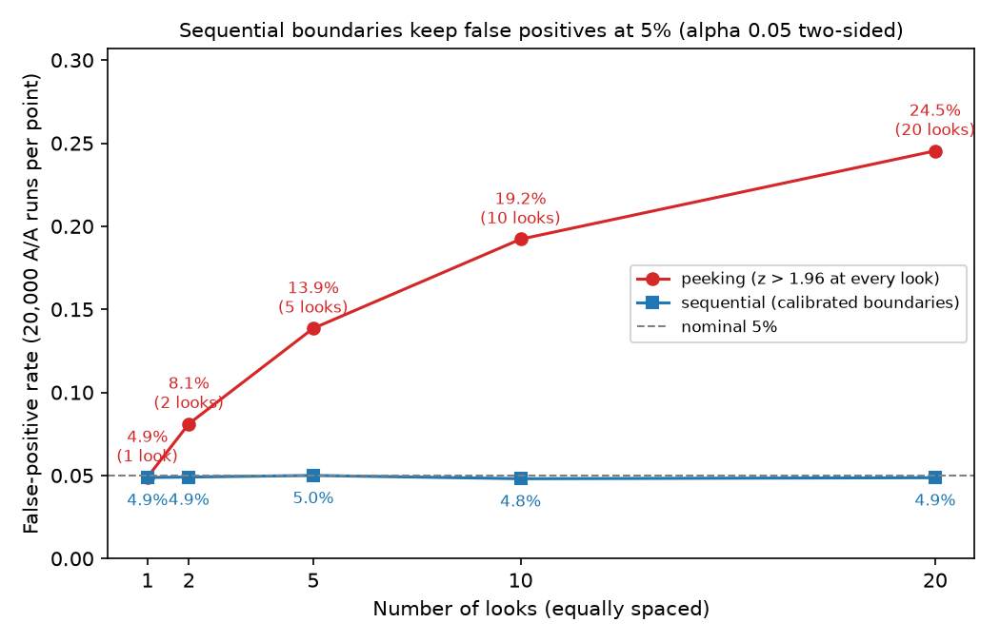
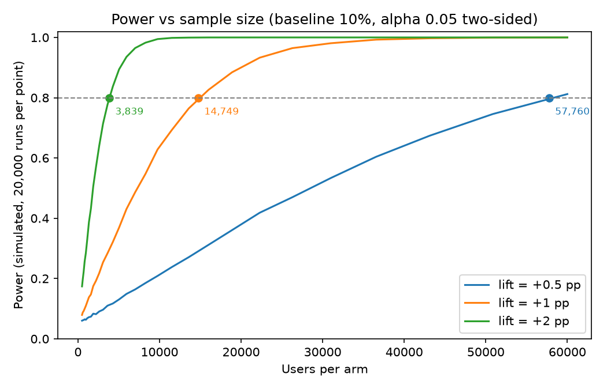
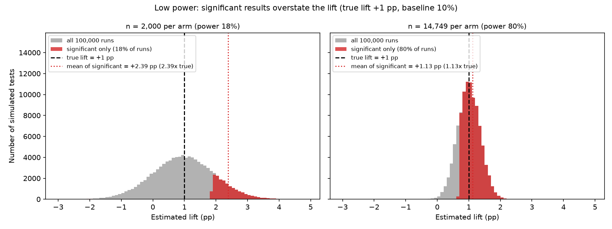
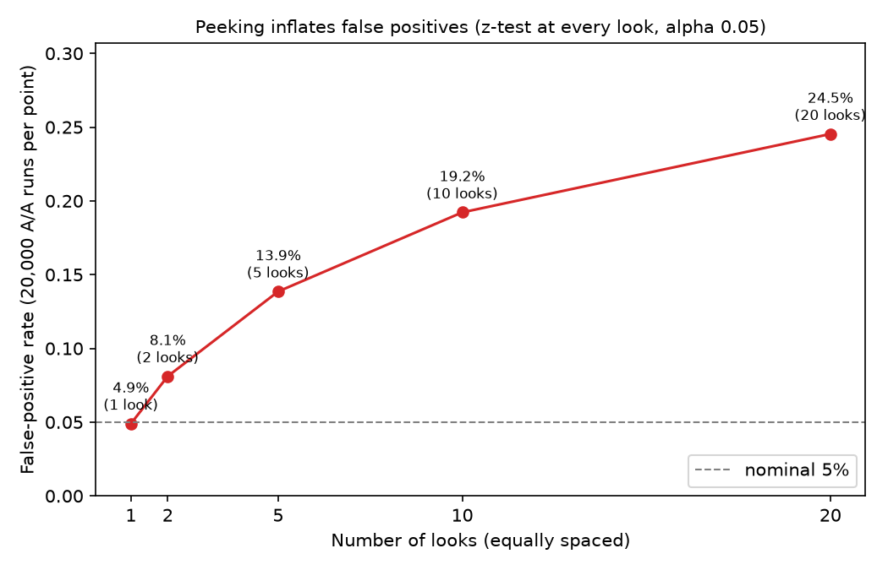
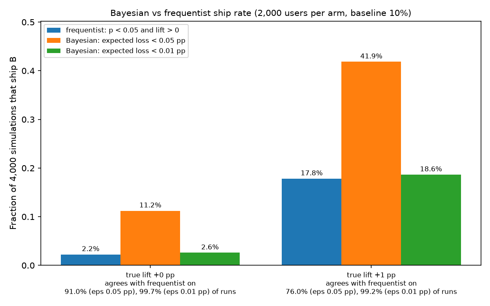

# ab-test-toolkit

Plan an A/B test, analyze its result and get a launch verdict, with Monte Carlo simulations that check the methods against known truth and show how tests go wrong.

**Python 3.10+** · NumPy · SciPy · Matplotlib

<p align="center"></p>

## Highlights

* **Planning, analysis and a decision in one place.** Sample size, minimum detectable effect, two proportion z test, confidence intervals, a sample ratio mismatch check and a five way launch verdict that compares the interval with a practical threshold you choose before looking at results. A CLI runs it on a CSV.
* **Verified by simulation.** The vectorized simulator draws conversion counts from known true effects, so the test's false positive rate (5.1%), the CI's coverage (95.0%) and the planned power can be measured. `analyze_batch` is tested to equal the scalar functions element by element.
* **Shows the failure modes.** Underpowered tests exaggerate the effect they detect (type M error), and peeking at 10 interim looks raises false positives from 5% to 19.2%.
* **Sequential testing, calibrated by simulation.** The boundary constant of an O'Brien and Fleming style rule is found by Monte Carlo. It keeps false positives at 4.8% to 5.0% for 2 to 20 looks, at a power cost of 1.7 percentage points.
* **Bayesian comparison.** Beta Binomial posteriors with an expected loss rule, compared head to head with the frequentist rule.
* **256 tests**, including cross checks against `statsmodels` and the simulation calibration bands.

## What it is, and what it is not

It is a planning and analysis library for a **binary conversion metric** (converted or not) with two arms, plus a simulation harness.

It does **not** randomize users, log events or run experiments on real users, and it is not an experimentation platform or a replacement for `statsmodels` or `scipy`. The example data in `tests/data/example.csv` is a synthetic fixture. All results below come from simulated data with known truth.

## Results

Every number below is printed by `python scripts/make_figures.py` or asserted in `tests/` (seeds are fixed, so reruns reproduce them). Baseline conversion is 10% throughout.

### Calibration: do the methods deliver the error rates they claim?

A/A tests (no true effect), 5,000 users per arm, 20,000 simulations.

| Check                                    | Result | Test band (`tests/test_calibration.py`) |
| ---------------------------------------- | ------ | ----------------------------------------- |
| False positive rate at alpha = 0.05      | 5.1%   | 4.5% to 5.5%                              |
| Coverage of the 95% CI (true lift +1 pp) | 95.0%  | 94% to 96%                                |

### Sample size and power

`plan` for a +1 pp lift (10% to 11%) needs **14,749 users per arm** at alpha 0.05 (two sided) and 80% power. Halving the effect to +0.5 pp needs 57,760. The simulated power curves cross 80% at those planned sizes.



### Low power exaggerates the effect (type M error)

True lift +1 pp, 100,000 simulations each (`exaggeration_stats`).

| Users per arm | Power | Significant runs: average estimate vs truth | Wrong sign (type S) |
| ------------- | ----- | ------------------------------------------- | ------------------- |
| 2,000         | 17.6% | about 2.4x the true lift                    | 0.7%                |
| 14,749        | 79.9% | about 1.1x                                  | 0%                  |

At 2,000 users per arm, only the runs where noise pushed the estimate far above +1 pp cross the significance line, so the results you would report as wins are overstated.



### Peeking inflates false positives, sequential boundaries fix it

A/A data, 10,000 users per arm in total, 20,000 simulations, equally spaced looks.

| Looks | Peeking (z > 1.96 at every look) | Sequential boundary | Constant `c` |
| ----: | -------------------------------: | ------------------: | -------------: |
|     1 |                             4.9% |                4.9% |          1.963 |
|     2 |                             8.1% |                4.9% |          1.975 |
|     5 |                            13.9% |                5.0% |          2.033 |
|    10 |                            19.2% |                4.8% |          2.084 |
|    20 |                            24.5% |                4.9% |          2.123 |

The critical z at look `k` of `K` is `c * sqrt(K / k)`. For 10 looks it runs from 6.59 at the first look down to 2.08 at the last. `c` is found by simulating the null random walk, not by a formula.

The cost, at true lift +1 pp with 14,749 users per arm and 100,000 simulations:

| Rule                                              | Power |
| ------------------------------------------------- | ----: |
| Single fixed horizon test                         | 80.2% |
| Sequential, 10 looks                              | 78.5% |
| Peeking at 1.96, 10 looks (19.2% false positives) | 86.8% |

The sequential rule costs about 1.7 percentage points of power. Peeking appears to have more power only because its false positive rate is inflated.



### Bayesian versus frequentist

2,000 users per arm, 4,000 simulations per scenario. The frequentist rule ships B when p < 0.05 and the lift is positive. The Bayesian rule ships B when the expected loss of choosing B (the average conversion rate given up if B is actually worse) is below `epsilon`.

| True lift | Frequentist ships | Bayesian, epsilon 0.05 pp | Bayesian, epsilon 0.01 pp |
| --------- | ----------------: | ------------------------: | ------------------------: |
| 0 pp      |                2% |                       11% |                        3% |
| +1 pp     |               18% |                       42% |                       19% |

The Bayesian rule does not control false positives at 5%. It controls the expected loss, and `epsilon` decides how strict it is: 0.05 pp behaves like a z cutoff of about 1.23, 0.01 pp like about 1.92, against 1.96 for the frequentist rule. The uniform prior and `epsilon` are assumptions.



## How it works

* **z test and CI.** The test uses the pooled standard error because the null says both arms share one rate. The CI uses the unpooled standard error because it does not assume the null, so the two can disagree on borderline cases.
* **Sample size.** By the CLT the difference in rates is approximately normal, which gives `n = (z_{1-alpha/2} + z_power)^2 (p1 q1 + p2 q2) / mde^2`. `mde_at_n` has no closed form, so it solves for the lift numerically with `scipy.optimize.brentq`.
* **Simulation.** Conversion counts are drawn directly as `Binomial(n, p)`, which is equivalent to simulating each user and far faster. For peeking, each look draws the new users' counts and adds them to running totals, so memory stays small.
* **Sequential boundary.** Under the null the standardized statistic is a random walk. A look rejects when `|Z_k| >= c * sqrt(K / k)`, which is the same as `max over k of |S_k| / sqrt(K) >= c`, so `c` is the 95th percentile of that maximum.

### Decision rules

`decide(low, high, delta)` takes the confidence interval on the absolute lift and the smallest lift worth shipping, and checks these rules in order:

| Order | Condition                        | Verdict                    |
| ----- | -------------------------------- | -------------------------- |
| 1     | `low >= delta`                 | `LAUNCH`                 |
| 2     | `high < 0`                     | `HARMFUL`                |
| 3     | `high < delta` and `low > 0` | `STAT_SIG_NOT_PRACTICAL` |
| 4     | `high < delta`                 | `NO_MEANINGFUL_EFFECT`   |
| 5     | otherwise                        | `INCONCLUSIVE`           |

## Quickstart

```
git clone https://github.com/T6523/ab-test-toolkit.git
cd ab-test-toolkit
python -m venv .venv && source .venv/bin/activate
pip install -e ".[dev]"
pytest -q                          # 256 tests
python scripts/make_figures.py     # regenerates figures/ and prints the tables above
```

Plan a test:

```
$ python -m abkit plan --baseline 0.10 --mde 0.01
Baseline conversion:      10.00%
Minimum detectable lift:  +1.00 pp (+10.0% relative)
Significance level:       alpha = 0.05 (two-sided)
Power:                    80%
Required sample size:     14,749 per arm (29,498 total)
```

Analyze a CSV with columns `variant` (`control` or `treatment`) and `outcome` (0 or 1). `--delta` is the practical threshold and is required:

```
$ python -m abkit analyze tests/data/example.csv --delta 0.005
Arm        Users   Conversions  Rate
control    10,000  1,000        10.00%
treatment  10,000  1,100        11.00%

SRM check (expected 50/50): chi2 = 0.000, p = 1.0000 -> OK
Lift:     +1.00 pp (+10.0% relative)
p-value:  0.0211 (two-sided z-test, pooled SE)
95% CI:   [+0.15 pp, +1.85 pp]
Delta:    0.50 pp
Verdict:  INCONCLUSIVE
          The interval spans the practical threshold: the data cannot separate a worthwhile lift from a smaller one. Collect more data.
```

The result is significant (p = 0.021), yet the verdict is `INCONCLUSIVE` because the interval's lower end (+0.15 pp) is below the +0.5 pp threshold. If the arm sizes differ from the planned split, `analyze` prints a warning and tells you not to trust the results.

From Python:

```python
from abkit.analysis import lift_ci
from abkit.decide import decide

low, high = lift_ci(1000, 10000, 1100, 10000)
print(decide(low, high, delta=0.005).name)   # INCONCLUSIVE
```

## Project structure

```
abkit/
  analysis.py     z test, absolute and relative lift CIs
  planning.py     sample size, power, minimum detectable effect
  decide.py       Verdict and decide()
  srm.py          sample ratio mismatch check
  cli.py          plan and analyze commands
  sim.py          vectorized simulator, calibration, power curves, type M and S errors
  sequential.py   peeking, calibrated O'Brien and Fleming style boundaries
  bayes.py        Beta Binomial comparison with expected loss
scripts/make_figures.py   regenerates every figure and prints the tables
tests/                    256 tests, including statsmodels cross checks
figures/                  generated figures
```

## Limitations

* Binary conversion metric and two arms only. Continuous and ratio metrics, several variants and multiple comparison corrections are not implemented.
* The sequential boundaries are valid only for a number of equally spaced looks that is planned in advance, and `c` is calibrated with a Gaussian approximation (checked here against binomial data at 1, 2, 5, 10 and 20 looks).
* The relative lift CI divides the absolute CI by the control rate and treats that rate as fixed, so the true interval is somewhat wider.
* `decide` looks at the lift interval only, not at guardrail metrics.
* The Bayesian rule depends on a uniform prior and on `epsilon`, both assumptions.
* All results are simulated with a fixed true effect and independent users.

## References

* Gelman, A. and Carlin, J. (2014). Beyond Power Calculations: Assessing Type S (Sign) and Type M (Magnitude) Errors. *Perspectives on Psychological Science*, 9(6).
* O'Brien, P. C. and Fleming, T. R. (1979). A multiple testing procedure for clinical trials. *Biometrics*, 35(3).

## License

MIT, see [LICENSE](LICENSE).
